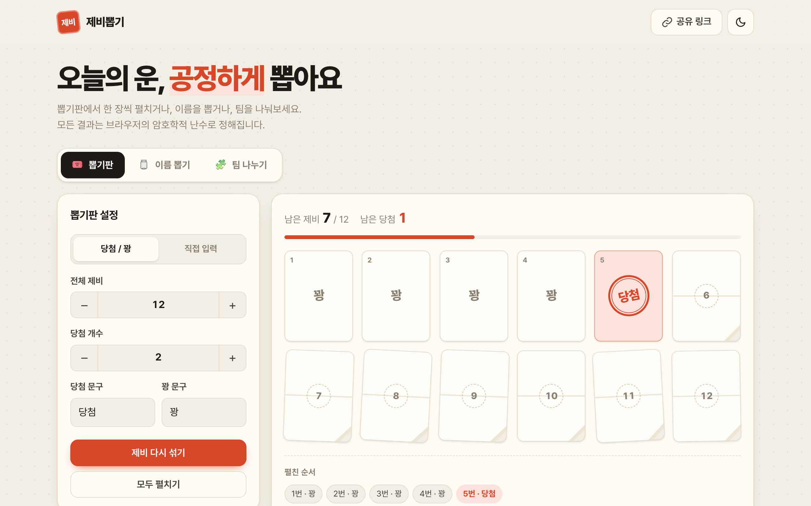

# 🎁 마니또 뽑기

설치나 가입 없이 브라우저에서 바로 쓰는 마니또 뽑기 웹앱입니다.
진행자가 방을 만들어 초대 링크를 보내면, 각자 자기 마니또만 몰래 확인할 수 있습니다.

**▶ 바로 사용하기: https://dongpari21.github.io/jebi/**



## 기능

| 방식 | 설명 |
| --- | --- |
| **온라인 방** | 진행자가 방을 만들고 초대 링크를 보냅니다. 참가자는 이름만 입력하고 입장하고, 진행자가 **방 구성 완료**를 누르면 각자 화면에 자기 마니또가 실시간으로 열립니다. |
| **모여서 뽑기** | 한자리에 모였을 때 한 기기를 돌려가며 각자 몰래 확인합니다. 서버를 쓰지 않습니다. |

- **공정한 배정**: 참가자를 `crypto.getRandomValues` 기반 Fisher–Yates로 섞은 뒤 원형으로 이어(A→B→…→A) 배정합니다. 모든 배치가 같은 확률로 나오고, 3명 이상이면 자기 자신이나 서로를 챙기는 쌍이 생기지 않습니다.
- **본인만 확인**: 배정 결과는 `rooms/{id}/secrets/{uid}`에 저장되고, [Firestore 보안 규칙](firestore.rules)으로 **본인만 읽을 수 있습니다**. 진행자도 남의 결과는 읽을 수 없고, 구성 완료 후에는 결과 수정이나 추가 입장이 막힙니다.
- **전원 동의 시 공개**: 구성 후 참가자 모두가 공개에 동의하면 전체 명단이 열립니다. 동의할 때 자기 결과를 `reveals/{uid}`에 넣는데, 규칙상 내 실제 결과와 같아야 하고, 동의 수(`revealVotes`)가 참가 인원(`memberCount`)에 이르기 전에는 방장을 포함해 누구도 읽을 수 없습니다. 동의하지 않은 사람의 결과는 어떤 경우에도 공개되지 않습니다.
- **방 관리**: 방장은 자기가 만든 방 목록을 보고, 방 이름을 바꾸거나 명단·결과까지 통째로 삭제할 수 있습니다.
- **실시간**: 입장 명단, 구성 완료, 공개 동의 현황이 `onSnapshot`으로 즉시 반영됩니다.
- **가입 없음**: Firebase 익명 로그인을 써서, 같은 기기·브라우저로 링크를 다시 열면 내 정보가 유지됩니다.
- 다크 모드, 반응형 레이아웃, `prefers-reduced-motion` 대응

## 기술 스택

빌드 도구나 프레임워크 없이 **HTML, CSS, JavaScript(ES Modules)** 로 만들었고, 온라인 방에만 **Firebase**(Anonymous Auth, Cloud Firestore)를 사용합니다. Firebase SDK는 온라인 방을 쓸 때만 불러옵니다.

```
index.html
css/style.css          디자인 토큰(라이트/다크), 레이아웃, 애니메이션
js/app.js              탭, 모여서 뽑기, 결과 확인 대화상자
js/manitto-room.js     온라인 방 (진행자 관리 화면, 참가자 방 화면)
js/room-api.js         Firebase 데이터 계층 (익명 로그인, 방·참가자·결과)
js/firebase-config.js  Firebase 웹 앱 설정
js/random.js           암호학적 난수 셔플
js/confetti.js         의존성 없는 캔버스 컨페티
js/utils.js            DOM·클립보드·공유 유틸
firestore.rules        Firestore 보안 규칙
```

## 로컬에서 실행

ES Modules를 쓰기 때문에 정적 서버로 열어야 합니다.

```bash
python3 -m http.server 8000
# http://localhost:8000 접속
```
